# Victory sur macOS

<a href="docs/macos/m2-series-s-cour.png">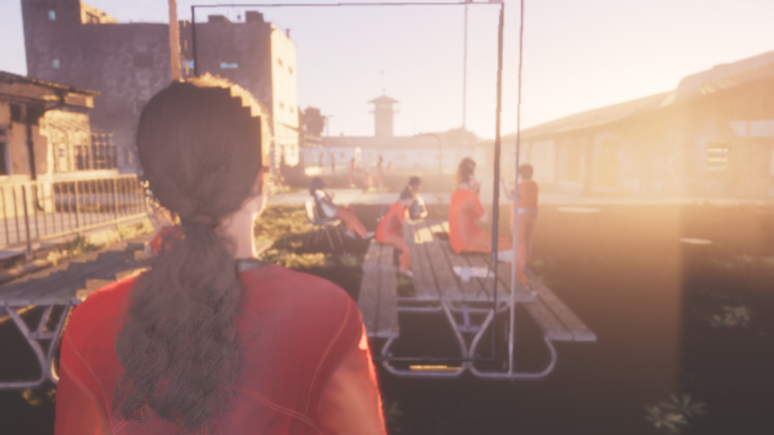</a>

*Prison, profil Series S sur Mac M2 avec 24 Go de mémoire unifiée. Capture en jeu du 28 novembre 2026.*

| Depuis le seuil de la cellule | Sous les plafonniers |
| --- | --- |
| [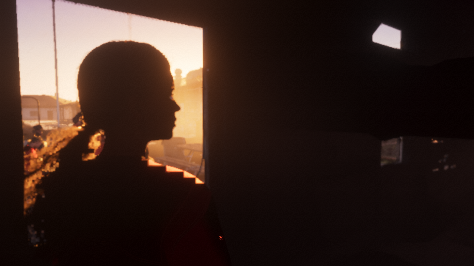](docs/macos/m2-series-s-seuil.png) | [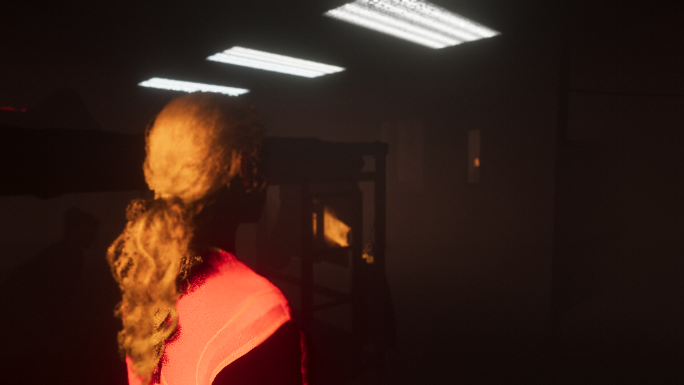](docs/macos/m2-series-s-cellule.png) |

Le lanceur **Series S sur Mac** utilise la DualSense physique via GameController. Un appui sur Croix a été mesuré à 127 ms sur macOS et 131 ms dans le panneau de Victory. Le panneau suit aussi les boutons quand le jeu perd le focus. [Lanceur Series S](tools/run_victory_series_s_mac.command)

La session photographiée a chargé **2 319 traductions en 143 ms**, puis **682 en 42 ms**. Quatre travailleurs préparent les pipelines graphiques. Le moteur charge en priorité les textures des matériaux dessinés. Les trois néons sont visibles dans la cellule, dont le fond et les lits restent sombres. Un prélèvement de 329 cibles a occupé une trame de 40,6 secondes et le jeu a interrompu cette session. [Mesures et empreintes](docs/macos/013918-series-s-m2.json)

Pour reconstruire le moteur utilisé dans ces trois captures, la branche `series-s-m2-013918` contient les sources de cet essai. Le raccourci accepte les chemins de votre installation Wine et de votre copie du jeu. Les caches et les données du joueur se préparent localement. [Sources du moteur photographié](https://github.com/Mirakud/victory-fork-macOS/tree/series-s-m2-013918) · [Compilation sous Windows et lancement sur macOS](#démarrer-victory)

## Prison sur Mac M3, 27 novembre

<a href="docs/macos/030001-prison-cour.png">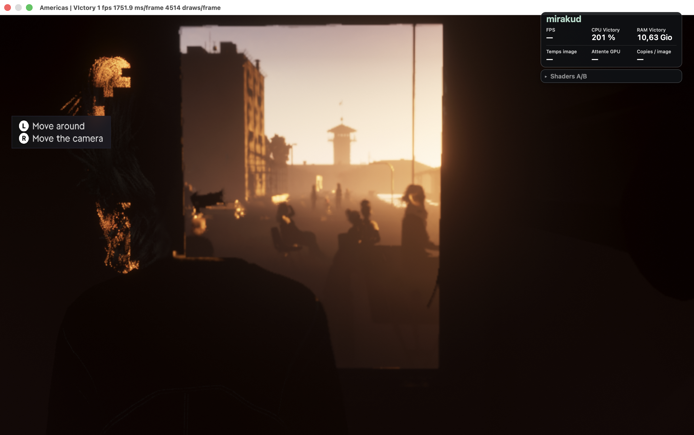</a>

*Premiers déplacements dans la prison sur Mac M3.*

| Personnage de profil dans la prison | Menu Game sur macOS |
| --- | --- |
| <a href="docs/macos/030001-prison-profil.png">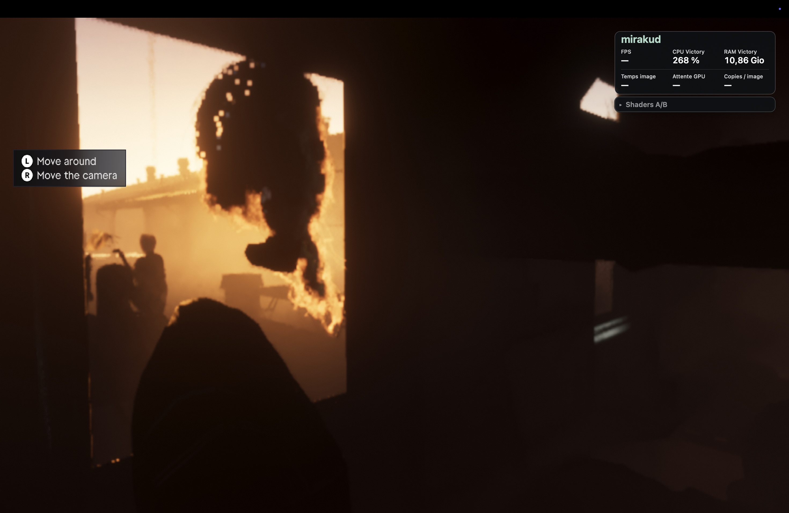</a> | <a href="docs/macos/menu-game-macos.png">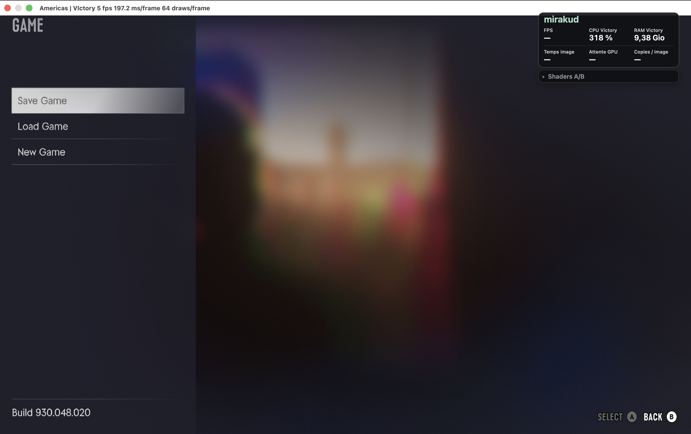</a> |

Sur la capture du menu, la fenêtre indique 5 FPS, 197,2 ms par image et 64 appels de dessin.

Victory traduit les appels d’un titre Xbox Series vers Direct3D 12. Le 27 novembre 2026, Mirakud a franchi la cinématique puis déplacé le personnage dans la prison avec le profil Series S, Wine Sikarugir et D3DMetal 4.0 bêta 3. La capture indique 1 751,9 ms par image et 4 514 dessins par image. Sur cette première version, le visage et le cou apparaissent par fragments.

Le lanceur local `tools/run_victory_d3dmetal4_mac.command` a sélectionné le moteur `6c32891` et le traducteur historique. Il a chargé 2 319 shaders en 118 ms et 187 traductions complémentaires en 9 ms. Belobug est un profil expérimental distinct. Le moniteur a enregistré 30 min 17 s avant une violation d’accès et une sortie avec le code 5. [Empreintes de la session 030001](docs/macos/030001.json) · [Lancer le profil prison](#démarrer-victory)

## Tête et cou dans la prison sur Mac M3

Le profil **Prison avec HUD** atteint la cour avec le moteur `b2f29fc` et un seul travailleur DirectStorage. Sur la vue de trois quarts, la nuque rejoint le col. En masquant les cheveux, on retrouve le crâne, les deux oreilles et la nuque dans la couleur du matériau et dans la profondeur. Les deux prises de vue ont des angles légèrement différents. [Voir les images de couleur et de profondeur](docs/macos/visage-et-cou-macos.png)

[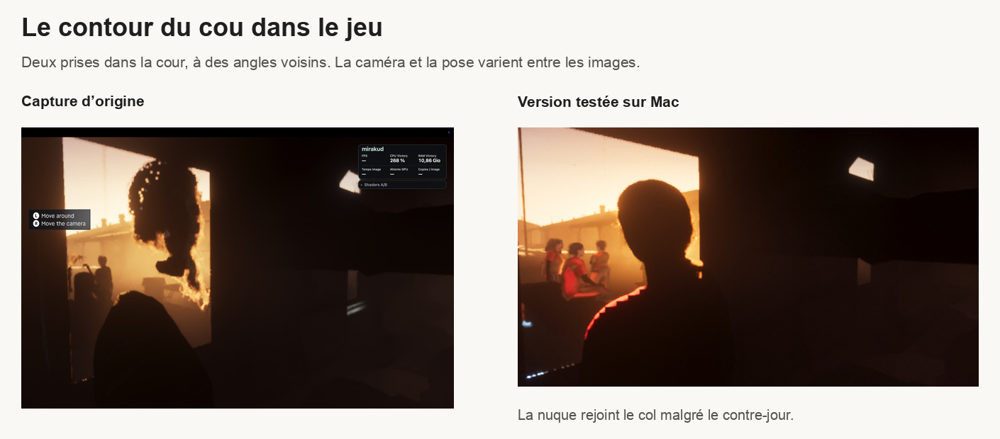](docs/macos/cou-en-jeu-avant-apres.jpg)

Le visage reste très sombre à contre-jour. Sur secteur, avec la coiffure rétablie et la caméra immobile, dix images consécutives prennent **2,795 s en médiane**, soit **0,351 image/s** sur la séquence. Le pack expérimental d’ombres en cascades de Belobug était désactivé pendant cette mesure. [Temps de chaque image et empreintes du moteur et des caches](docs/macos/124802-prison.json)

## Essai 011924 du 27 novembre 2026

Le Mac M3 de 16 Gio a enregistré **178 présentations consécutives**, de 2365 à 2542, sous Wine Sikarugir et D3DMetal 4.0 bêta 3. La ville se distingue dès la présentation 2369. Le générique se poursuit jusqu’au littoral. Les bandes noires se rétractent dans les dernières images. Le moniteur a arrêté l’essai à 9 369,3 Mio de mémoire câblée pour un plafond configuré à 9 216 Mio. La rotation inverse de la caméra et la reprise du contrôle du personnage restent à vérifier.

Victory a chargé les 2 319 shaders du pack en 128 ms, puis ses 25 traductions complémentaires en 1 ms. Victory enregistre le conteneur et l’empreinte complète des traductions manquantes qui aboutissent. Après l’arrêt, le préparateur natif a ajouté 96 variantes au complément, portant son total à 121 pour le parcours suivant. Le bouton **Shaders A/B** permet de masquer ou d’isoler une paire graphique, d’en ajouter une autre puis de rétablir tous les dessins.

Les 17 premiers relevés de monde à plus de 1 000 Mo de copies ont pris **5,04 s par image en médiane**, dont 3,39 s de préparation des copies. Sur le parcours précédent avec le même budget de 256 Mio pour les miroirs, ces médianes étaient de 7,27 et 5,32 s. Les scènes et les réglages de lecture ont varié entre les deux parcours. Les vues d’écriture DirectStorage sous Wine ont été réutilisées 12 874 fois sur leurs 16 384 premières demandes. [Mesures de cet essai](docs/macos/011924-mesures.json)

<details>
<summary>Voir trois captures du parcours 011924</summary>

| Captures sur Mac M3 |
|:---|
| <a href="docs/macos/011924-frame-2410.png">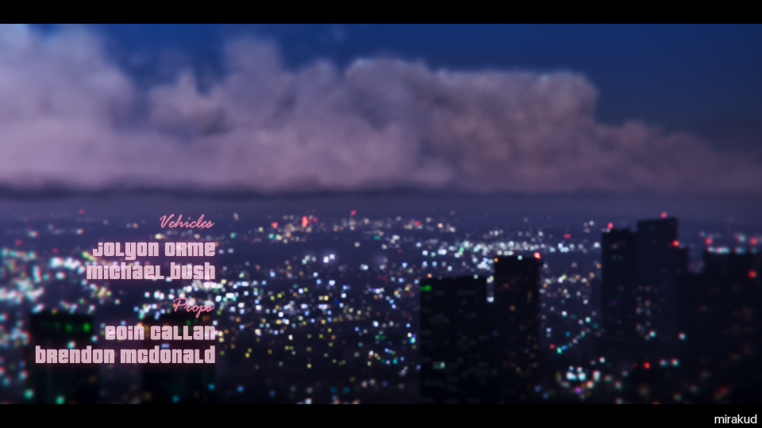</a><br>Générique sur la ville, présentation 2410 |
| <a href="docs/macos/011924-frame-2518.png">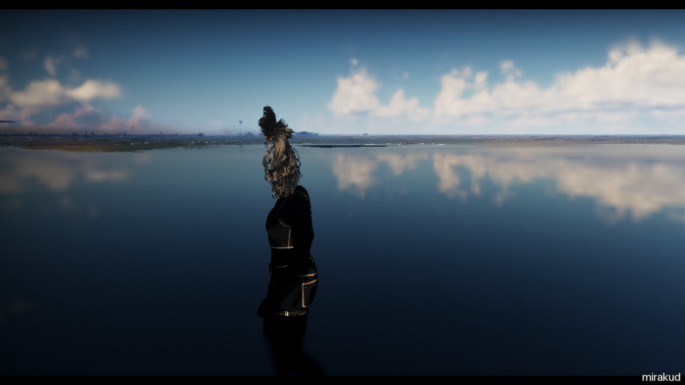</a><br>Littoral, présentation 2518 |
| <a href="docs/macos/011924-frame-2542.png">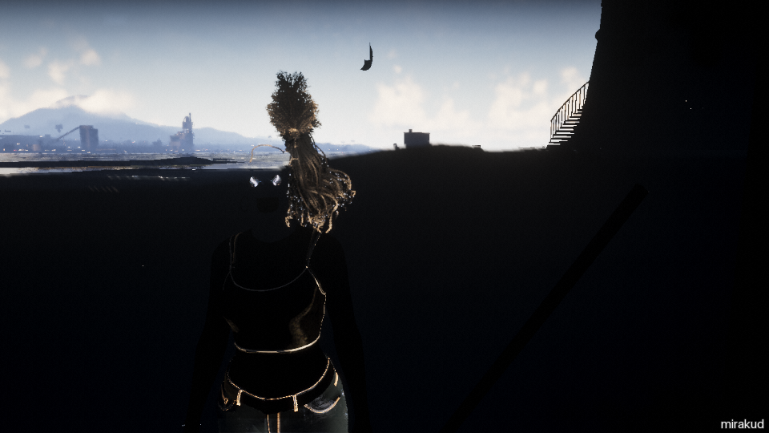</a><br>Dernière présentation, 2542 |

</details>

## La cinématique en images

| Captures sur Mac M3 |
|:---|
| <a href="docs/macos/202903-frame-1662.png"></a><br>**Contre-jour dans la rue** · essai 202903, trame 1662 |
| <a href="docs/macos/202903-frame-1712.png"></a><br>**Le pont au soleil couchant** · essai 202903, trame 1712 |
| <a href="docs/macos/frame-1864.png"></a><br>**Ciel orangé au-dessus de la ville** · essai 200227, trame 1864 |
| <a href="docs/macos/202903-frame-1670.png"></a><br>**Éclairage bleu au carrefour** · essai 202903, trame 1670 |
| <a href="docs/macos/frame-1840.png">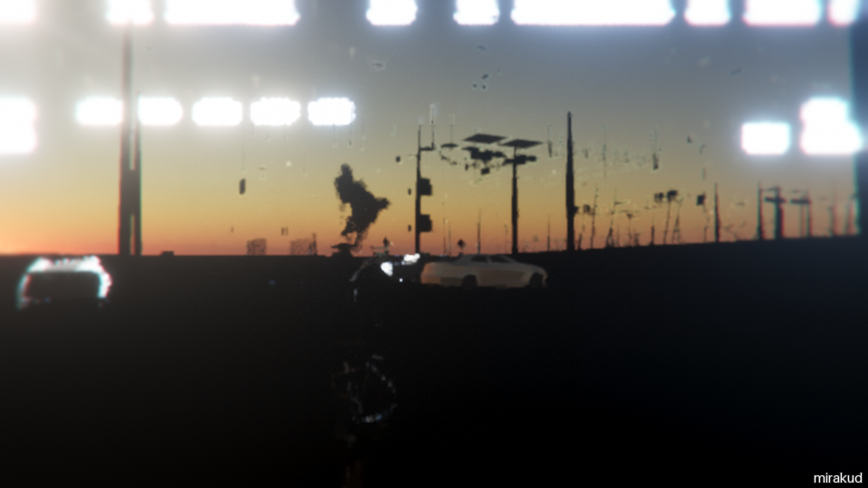</a><br>**Changement de lumière sur l’horizon** · essai 200227, trame 1840 |

<details open>
<summary>Voir les six autres captures de l’essai 200227, du fondu aux bâtiments</summary>

| Essai 200227 · D3DMetal 4 |
|:---|
| <a href="docs/macos/frame-1808.png">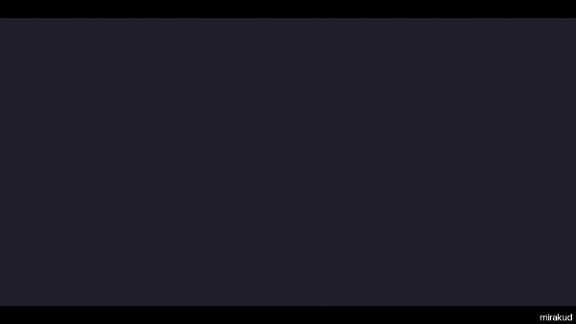</a><br>**Fondu avant la rue** · trame 1808 |
| <a href="docs/macos/frame-1816.png"></a><br>**Personnage devant la ville** · trame 1816 |
| <a href="docs/macos/frame-1824.png"></a><br>**Les feux de la rue** · trame 1824 |
| <a href="docs/macos/frame-1832.png">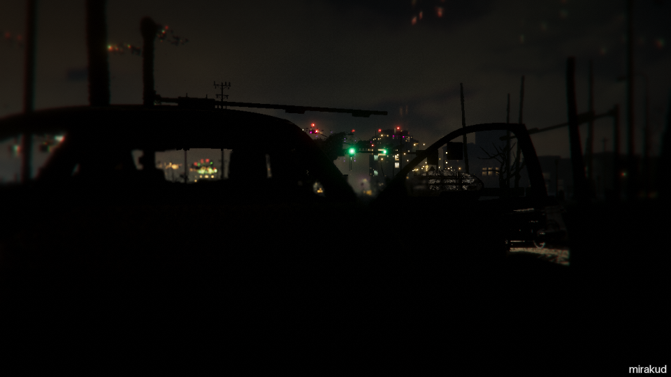</a><br>**Voiture au carrefour, portière ouverte** · trame 1832 |
| <a href="docs/macos/frame-1848.png">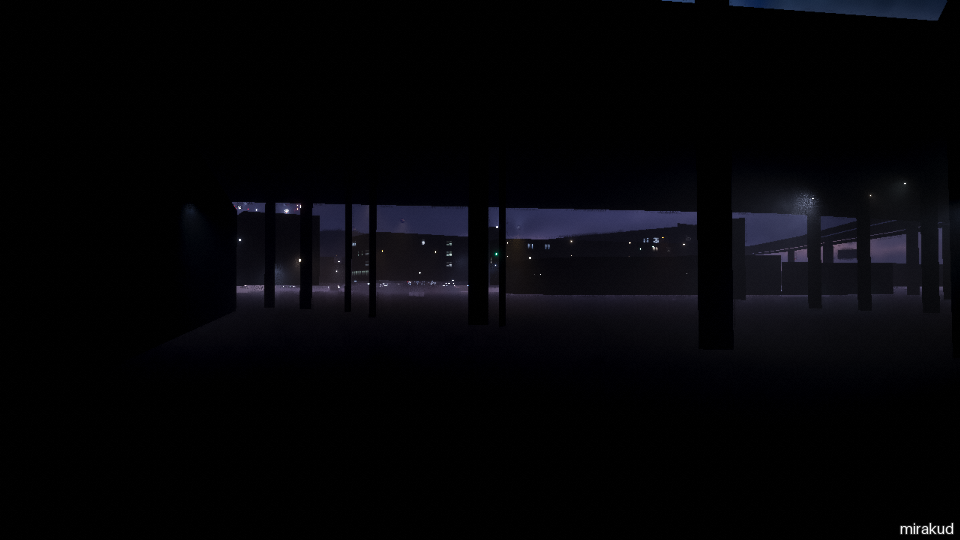</a><br>**Passage couvert** · trame 1848 |
| <a href="docs/macos/frame-1856.png"></a><br>**Bâtiments et apparition de la jauge** · trame 1856 |

</details>

<details>
<summary>Voir les trois captures de référence de la rue dans l’essai 191652</summary>

Les surfaces sombres et les matériaux qui apparaissent pendant la transition sont visibles sur ces captures du joueur.

| Essai 191652 · rue nocturne |
|:---|
| <a href="docs/macos/rue-1.png"></a><br>**Le carrefour avant le changement de plan** |
| <a href="docs/macos/rue-2.png"></a><br>**Les matériaux pendant la transition** |
| <a href="docs/macos/rue-3.png">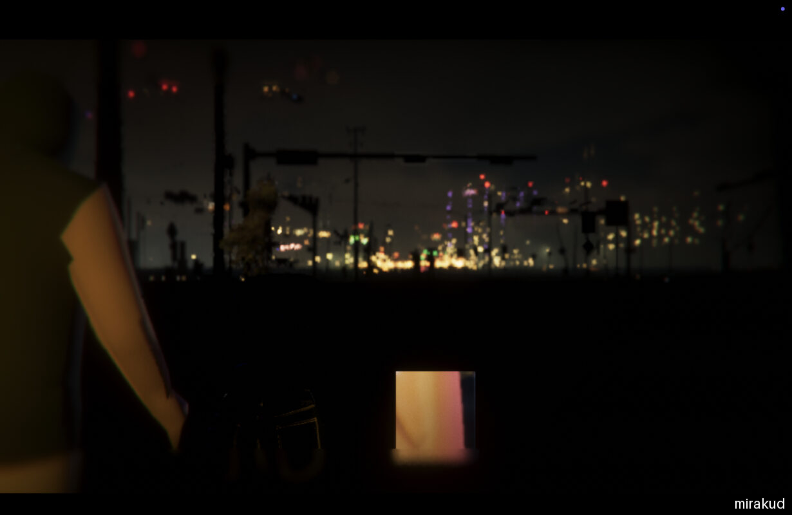</a><br>**Le personnage devant l’horizon** |

</details>

## État mesuré le 26 novembre 2026

Les essais ont utilisé un M3 de 16 Gio, Sikarugir Wine 10.0 révision 6, D3DMetal 4.0 bêta 3 et le profil Series S. Les médianes portent sur les relevés du journal dont la moyenne atteint 1 400 dessins par image. Le nombre de relevés, la caméra et l’avancement de la mission varient entre parcours. La différence de médianes ne mesure pas à elle seule un gain de performance.

| Essai | Relevés retenus | Médiane par image | Dont copies CPU | Pic de mémoire câblée macOS | Dernière trame du titre |
|---|---:|---:|---:|---:|---:|
| 191652, rue visible | 19 | 14,36 s | 9,08 s | 8 614 Mio | 963 |
| 195805, restauration de profondeur active | 6 | 6,85 s | 4,25 s | 8 662 Mio | 748 |
| 200227, jusqu’au plan du littoral | 36 | 10,02 s | 6,64 s | 9 126,7 Mio | 836 |
| 202903, capture continue du monde et encart actif | 45 | 11,10 s | 6,95 s | 9 129,1 Mio | 836 |

Les parcours 191652 et 195805 s’arrêtent sur la surveillance du titre. En 200227, le titre déclenche un point d’arrêt volontaire `0x80000003`. Son rapport à la trame 836 indique `INSTANCE_LIST 45000/45000`, contre `30819/45000` en 191652. Le lien causal avec la saturation de cette liste reste à établir. La garde mémoire était fixée à 9 216 Mio. Le relevé en jeu de 195805 atteint **1,0 restauration de profondeur par image**. Sur le banc D3DMetal séparé, trois tests passent. Les marches R16 0, 385, 32 768 et 65 535 produisent en D24 les valeurs hexadécimales 000000, 018101, 80007F et FFFFFF ; le stencil reste à 5A sur les quatre pixels. Le second dessin préserve également les profondeurs D32 de référence. [Sources du banc](crates/victory-gpu/src/host/depth_plane_readback.rs)

En 202903, le titre mesure **19 min 24 s** de fonctionnement, pour **19 min 34 s** écoulées sur le Mac. La session produit 124 PNG, dont 106 présentations consécutives du monde de la trame hôte 1647 à 1752 incluses. Le dernier plan montre un personnage de profil et des bâtiments. La prise de contrôle du personnage reste à vérifier.

Le rapport de 202903 s’arrête à la trame titre 836 avec `INSTANCE_LIST 45000/45000` et 1 094 demandes de streaming. Cette fois, le processus quitte avec le code 5 après une violation d’accès `0xc0000005` sur une écriture à l’adresse nulle. Les deux arrêts sur la même trame ont ainsi des exceptions différentes. Le relevé du pool ne permet pas encore d’attribuer la cause de l’arrêt.

## Construire

Le moteur de la cour testé avec le profil Prison avec HUD est issu de `b2f29fc`. Pour l’essai antérieur 011924, le candidat Victory était `6c32891`. Elle inclut la réserve étendue des pools, la réutilisation des vues DirectStorage sous Wine et le cache complémentaire de shaders. Les tests de profondeur proviennent de `95732f4` et `b6bf7c8`. La cadence de capture diagnostique provient de `4541df7`. En mode `VICTORY_CAPTURE_WORLD=only`, `VICTORY_CAPTURE_WORLD_INTERVAL=1` enregistre un PNG à chaque présentation du monde. Les intervalles de 1 à 64 sont acceptés. La recette du candidat mesuré `c949892` reste la référence de 195805 et de 200227. Le README amont conserve le détail des composants, le modèle d’exécution et les instructions du projet. [Documentation amont](README.amont.md) · [Architecture](docs/architecture.md) · [État du ray tracing](docs/fork-ray-tracing.md)

Dans un terminal de développement Windows x64 avec le SDK Windows, Rust MSVC, Python 3 et le DirectX Shader Compiler de Microsoft sur le PATH, lancer les commandes suivantes. Le script compile les noyaux HLSL du projet en DXIL local avant que Rust n’embarque leurs octets. Le paramètre `--dxc` accepte un chemin explicite.

```powershell
python tools/shaders/prepare.py
cargo build --locked --release -p victory --features diagnostics
cargo test --locked -p victory-gpu --features diagnostics depth_plane_readback -- --test-threads=1 --nocapture
```

Les deux tests de dessin ont besoin d’un périphérique D3D12 et des composants de compilation du runtime. Le profil diagnostics permet la capture et la télémétrie employées pendant les essais. Le dépôt distribue les sources des shaders ; DXC et les produits générés restent locaux.

## Lancer un essai sur Mac

### Préparer le Mac avec Uncork

1. Sur le Mac Apple Silicon, installez Uncork, puis ouvrez l’application. Les essais de ce fork ont utilisé Uncork 1.7.7. [Téléchargement officiel d’Uncork](https://uncorkmac.com/)
2. Dans les vérifications de l’environnement d’Uncork, acceptez la licence Apple pour télécharger les bibliothèques graphiques. Installez le moteur Wine **Sikarugir 10.0 révision 6** et connectez **D3DMetal**.
3. Créez ou ouvrez une bouteille Wine dédiée à Victory et sélectionnez **D3DMetal 4.0 bêta 3** pour cette bouteille. Repérez son dossier, celui qui contient `drive_c` et `dosdevices`. Dans la configuration testée, le lecteur `Z:` de la bouteille pointe vers `/` sur le Mac.

### Démarrer Victory

Depuis la racine du dépôt, utilisez Python 3.11 ou ultérieur. `SIKARUGIR_ENGINE` désigne le dossier du moteur installé par Uncork. Son emplacement par défaut pour cette version est le suivant.

```sh
export SIKARUGIR_ENGINE="$HOME/Library/Application Support/winebottle/Runtimes/sikarugir-10.0_6-gptk4.0b3"
```

Renseignez `VICTORY_BOTTLE` avec le chemin de la bouteille, `VICTORY_EXE` avec celui de `victory.exe` construit ci-dessus, `TITLE_EXE` avec celui de l’exécutable du titre dans votre copie préparée et `RUNS_DIR` avec le dossier où enregistrer les essais. Les chemins peuvent se trouver sur un volume externe monté. Prévisualisez la commande ci-dessous. Au lancement réel, le lanceur vérifie les empreintes SHA-256 des composants du moteur.

```sh
python3 tools/macos/run.py \
    --victory "$VICTORY_EXE" --title "$TITLE_EXE" \
    --engine "$SIKARUGIR_ENGINE" --bottle "$VICTORY_BOTTLE" \
    --output "$RUNS_DIR" --preview
```

Le raccourci du dépôt `tools/run_victory_d3dmetal4_mac.command` accepte les mêmes chemins et sélectionne directement le profil prison. Avec `run.py`, ajoutez `--prison-profile --data "$VICTORY_DATA"` à cette commande. Avec le raccourci, seul `--data "$VICTORY_DATA"` est à ajouter aux chemins. Pour reproduire le préchauffage, fournissez aussi `--shader-pack "$SHADER_PACK" --shader-overlay "$SHADER_OVERLAY" --pipeline-manifest "$PIPELINE_MANIFEST"` avec vos fichiers locaux compatibles. Ce profil active le panneau Shaders A/B, applique les distances de détail de la session et laisse macOS gérer la RAM. Le moniteur continue à surveiller les erreurs mémoire Metal.

Pour lancer **Prison avec HUD**, utilisez la commande ci-dessous avec le moteur construit depuis cette révision, votre profil et vos caches locaux. Le raccourci active la préparation des textures de peau et le panneau des entrées. Dans la cinématique, maintenez la commande **A** du jeu (croix sur DualSense).

```sh
./tools/run_victory_prison_avec_hud_mac.command \
    --victory "$VICTORY_EXE" --title "$TITLE_EXE" \
    --engine "$SIKARUGIR_ENGINE" --bottle "$VICTORY_BOTTLE" \
    --output "$RUNS_DIR" --data "$VICTORY_DATA" \
    --shader-pack "$SHADER_PACK" --shader-overlay "$SHADER_OVERLAY" \
    --shader-store "$SHADER_STORE" --pipeline-manifest "$PIPELINE_MANIFEST" --preview
```

Le dossier `SHADER_STORE` contient les traductions privées pour la version du traducteur utilisée. Le traducteur de cette publication et celui du banc local ont des empreintes différentes. Régénérez les packs et le répertoire de traductions avec le préparateur compilé depuis ce dépôt. Le catalogue JSON de noms peut être fourni avec `--shader-names` pour reconnaître davantage de paires dans le panneau. [Construction et vérification des caches](tools/shaders/prepare-arm64/USAGE.md)

Le profil mesuré utilisait une copie de Sikarugir équipée d’un pilote CoreAudio recompilé depuis Wine 10.0. Ce correctif permet aux minuteries des flux audio à l’arrêt de dormir jusqu’à leur reprise. Il s’applique à la racine des sources Wine 10.0 avec `patch -p1 < wine-10.0-coreaudio.diff.txt`. Le pilote conserve la licence LGPL-2.1-or-later. [Correctif source](docs/macos/wine-10.0-coreaudio.diff.txt) · [Licence Wine](docs/macos/wine-LGPL-2.1.txt)

Retirer `--preview` pour exécuter. `--data` copie les données privées d’un profil dans la nouvelle session. Les options `--shader-pack` et `--pipeline-manifest` acceptent des caches et priorités générés localement pour une version compatible. Au choix de profil du jeu, confirmer Player avec Entrée. Chaque session enregistre le journal et la télémétrie. Avec les profils de rue et de cinématique, le moniteur arrête le groupe de processus à 9 216 Mio câblés ou dès l’erreur Metal de mémoire insuffisante. Le lanceur reprend les réglages de base de la rue, tandis que les profils, priorités spécifiques et entrées utilisées lors du développement restent propres aux essais.

Pour reprendre les réglages de 011924, ajoutez `--intro-profile --data "$VICTORY_DATA"` avec votre dossier de profil. Activez `--shader-ab` pour isoler des paires graphiques dans le HUD et `--capture-shader-misses` pour enregistrer les conteneurs manquants dans le sous-dossier `shader-misses` de la session. Au lancement suivant, `--shader-overlay` accepte le fichier VSP1 préparé avec ces traductions. [Préparer et vérifier ses shaders sur Apple Silicon](tools/shaders/prepare-arm64/USAGE.md)

### Afficher les performances en jeu

Ajoutez `--perf-hud` à la commande macOS. L’encart AppKit marqué « mirakud » suit la fenêtre de jeu, à 50 pixels du bord supérieur et du bord droit, et laisse passer les clics. Il se ferme avec l’essai. Les outils en ligne de commande de Xcode fournissent Swift pour sa compilation locale.

```sh
python3 tools/macos/run.py --perf-hud \
    --victory "$VICTORY_EXE" --title "$TITLE_EXE" \
    --engine "$SIKARUGIR_ENGINE" --bottle "$VICTORY_BOTTLE" --output "$RUNS_DIR"
```

| Indicateur | Lecture |
|---|---|
| FPS et temps image | Les FPS valent 1 000 divisé par les millisecondes par image rapportées sur l’intervalle du journal. |
| CPU Victory | 100 % correspond à un cœur occupé. 240 % correspond à environ 2,4 cœurs. |
| RAM Victory | Empreinte physique du processus relevée par macOS. La garde utilise séparément la mémoire câblée de tout le système. |
| Attente GPU | Temps écoulé côté hôte pendant l’attente de la clôture D3D12, en millisecondes par image. Le moteur mesure cette attente avec son horloge CPU. |
| Copies / image | Temps hôte consacré à préparer les copies, en millisecondes par image. Ces mesures couvrent des opérations du moteur dont certaines peuvent se chevaucher. |

Sur le démarrage de l’essai 202903, le panneau a reçu **21,14 FPS, 47,3 ms par image, 241,6 % de CPU et 3 730 Mio** pour Victory. Ce relevé valide l’affichage pendant le démarrage. La table des résultats plus haut décrit la rue. Plus tard dans le monde, un relevé affiche **0,11 FPS**, 9,39 Gio de RAM, 300 % de CPU, 8 794 ms par image, 1 547 ms d’attente de clôture D3D12 et 6 119 ms de préparation des copies. L’image ci-dessous est le panneau rendu par AppKit à partir de ce relevé archivé. WindowServer a confirmé en jeu que le panneau se trouvait devant la fenêtre Victory, à 50 pixels des deux bords sur écran Retina.

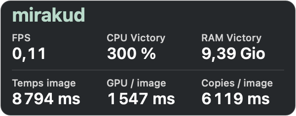

Une valeur absente ou périmée s’affiche sous la forme d’un tiret. Les comptes rendus de chaque session sont dans le dossier de sortie choisi. On peut les relire avec `python3 tools/macos/summarize_victory_run.py --help`.

### Examiner le visage avec Shaders A/B

Pour jouer, laissez le panneau replié. Pour examiner un défaut dans la cour, arrêtez la caméra, ouvrez **Shaders A/B**, choisissez **Paires de shaders** et cochez **Dernière image** puis **Personnage**. Choisissez **Visage et cou · peau** et cliquez sur **Masquer** pour voir quelles surfaces disparaissent. **Tout rétablir** ramène le rendu complet. **Isoler** affiche uniquement les dessins associés à la sélection.

Une paire rassemble les shaders de géométrie et de pixels. Un pipeline précise aussi comment effectuer le dessin, par exemple le test de profondeur ou le mélange des couleurs. Plusieurs pipelines peuvent utiliser la même paire. L’onglet **Pipelines** permet de cibler une seule de ces variantes quand le masquage de la paire affecte plusieurs surfaces.

Le panneau **Clavier** montre les touches reçues par Victory. Avec une DualSense détectée, le panneau voisin affiche les symboles PlayStation et le niveau des gâchettes. Le décodage et l’affichage ont été vérifiés sur banc. Un essai avec les boutons physiques de la manette dans la cour reste à confirmer.

## Crédits et provenance

Cette publication conserve les notices des projets et leur attribue les contributions intégrées. L’historique public de chacun reste accessible aux révisions indiquées.

| Projet | Contribution utilisée et provenance |
|---|---|
| VIctory, Marvisak et contributeurs | Chargeur, services du runtime, rendu D3D12 et recompilateur de shaders. Le fork Windows a démarré sur la révision `ffe310e`. GPL-3.0-or-later. [VIctory à cette révision](https://github.com/Marvisak/VIctory/commit/ffe310eb2098e52169f4c44db5ffdabf43a72622) |
| victory-fork, fxceless et contributeurs | Base directe du travail Mac, avec les ressources de rendu, le suivi des copies, les fenêtres de commandes indirectes et les files de soumission. L’ancêtre commun vérifié est `f85101b`. GPL-3.0-or-later. [Révision Windows](https://github.com/fxceless/victory-fork/commit/f85101b6095e8cf3cecf8f0647cc7f5428daa177) |
| victory-amd, myokex et contributeurs | Suivi des écritures à travers les vues d’une même page par myokex, d’après Spexivus, joroyt et tightfall. Lecture dans un tampon temporaire avant copie vers les pages du titre par Joshua Odom. Ces contributions ont été reprises dans la base Windows. [Gardes de page](https://github.com/myokex/victory-amd/commit/c6dc4d8c9fc80e8d2090f94287827cd3ffc0ac95) · [Lecture temporaire](https://github.com/myokex/victory-amd/commit/10ea38ed80e944e052b5f2221eee02b1717eda2b) |
| triippywhale et asdaasdsaddf | La base Windows a intégré les bornes du tas de vues de triippywhale et des correctifs de traduction des shaders et d’interpolation d’asdaasdsaddf. [Intégration des vues](https://github.com/fxceless/victory-fork/commit/31714deb2d70bb7c5a963658ad0faed0368526c6) · [Intégration des shaders](https://github.com/fxceless/victory-fork/commit/3bff182ef4966ad6986fd8552dc9c7c58268df07) |
| VIctory-macOS, pragyaangaur et contributeurs | Le diagnostic d’identités DXIL distinctes pour le cache D3DMetal a servi au port de l’identifiant de shader dans notre intégration Mac, conservé dans `crates/victory-shader/src/emit/container.rs`. La sélection des plans de présentation a servi de référence pour diagnostiquer les premiers écrans noirs. Le travail de **Stefa008** sur les conversions des canaux d’un export mesh avant ses écritures a inspiré les adaptations `054aaf5`, `24cbffc` et `8eaafd5`, présentes dans notre candidat. [Contribution de Stefa008](https://github.com/pragyaangaur/VIctory-macOS/pull/167) · [Diagnostic des hashes D3DMetal](https://github.com/pragyaangaur/VIctory-macOS/blob/a76ec9662bce135d90e15d28621da208409eef17/docs/macos.md#d3dmetals-shader-cache-needs-unique-shader-hashes) · [Plans présentés](https://github.com/pragyaangaur/VIctory-macOS/commit/87b6f05e90761cb4ff5f0ab55e546951d51edffd) |
| Belobug et contributeurs | Le profil expérimental de la cascade accepte la traduction vérifiée d’un shader de calcul issue du fork Belobug. La cour documentée avec le profil Prison avec HUD utilise le traducteur ordinaire. [Source de Belobug à la révision étudiée](https://github.com/Belobug/VIctory-Belobug-AMD/tree/4eb6cfdf9e61cb112f1f811344ec0dd309eddd6c) |
| XCL, ivall et contributeurs | Référence comparative pour le comportement du titre dans une autre couche de compatibilité. Son dépôt est aujourd’hui sous xcl-dev et sa licence est GPL-2.0-only. [Projet XCL](https://github.com/xcl-dev/xcl) |
| Mirakud | Intégration et essais sur le M3, parcours et statistiques documentés ici, lanceur macOS, garde mémoire, encart natif et publication des sources. [Banc de profondeur](crates/victory-gpu/src/host/depth_plane_readback.rs) · [Outils macOS](tools/macos) |

Le moteur utilisé en externe associe Wine Sikarugir à D3DMetal du Game Porting Toolkit d’Apple, installé avec Uncork. La préparation Windows emploie le compilateur DirectX Shader Compiler de Microsoft. Ces composants conservent leurs conditions de distribution propres. [Sikarugir](https://github.com/Sikarugir-App/Sikarugir) · [Uncork](https://uncorkmac.com/) · [Game Porting Toolkit](https://developer.apple.com/games/game-porting-toolkit/) · [DirectX Shader Compiler](https://github.com/microsoft/DirectXShaderCompiler)

Les dépendances Rust sont épinglées par Cargo. Figurent notamment windows-rs 0.62.2 pour les interfaces Windows (MIT ou Apache-2.0), zlib-rs 0.6.8 pour la décompression (Zlib), opus-pure 0.2.4 pour l’audio (BSD-3-Clause) et BLAKE3 1.8.7 pour les empreintes (CC0-1.0 ou les options Apache indiquées par le projet). [Versions](Cargo.lock) · [windows-rs](https://github.com/microsoft/windows-rs) · [zlib-rs](https://github.com/trifectatechfoundation/zlib-rs) · [opus-pure](https://github.com/stephenberry/opus-pure) · [BLAKE3](https://github.com/BLAKE3-team/BLAKE3)

## Licence et contenu

Le code Victory est distribué sous GPL-3.0-or-later. Les attributions et notices d’origine sont conservées. Les tables constantes du format BCPack gardent leur statut particulier documenté en amont. Les captures originales de la prison et du menu portent la signature « mirakud » dans l’encart supérieur droit. Les copies des essais précédents portent la signature « mirakud » en bas à droite. Le générateur contrôle la conservation de chaque pixel hors de cette signature. Les captures illustrent exclusivement les essais de ce fork ; la licence du code ne s’applique pas aux images du titre. [Licence](LICENSE) · [Règles amont relatives aux ressources](docs/asset-policy.md)
