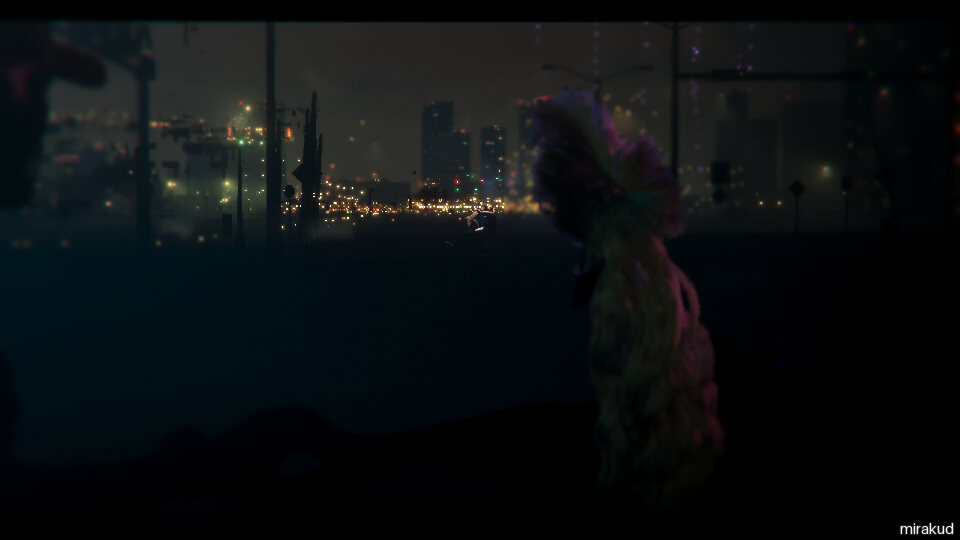
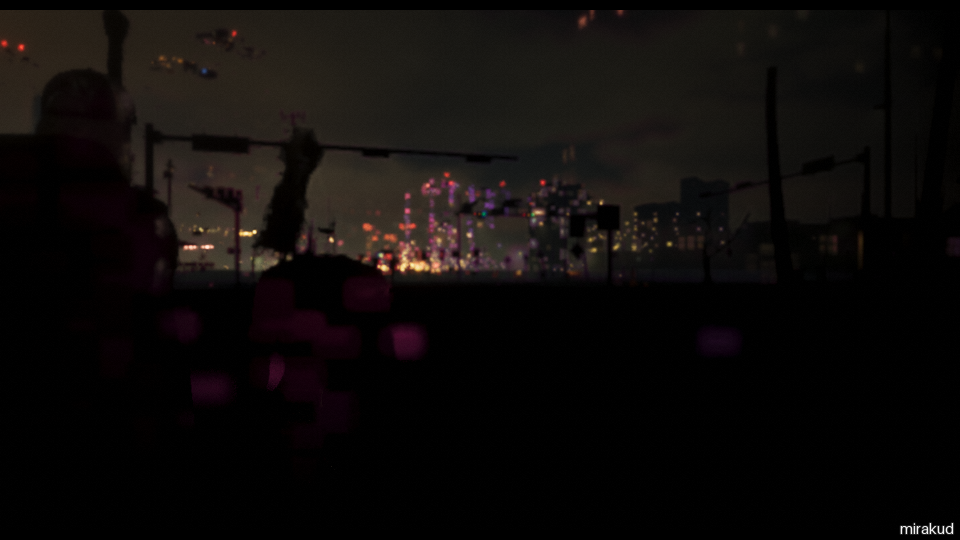
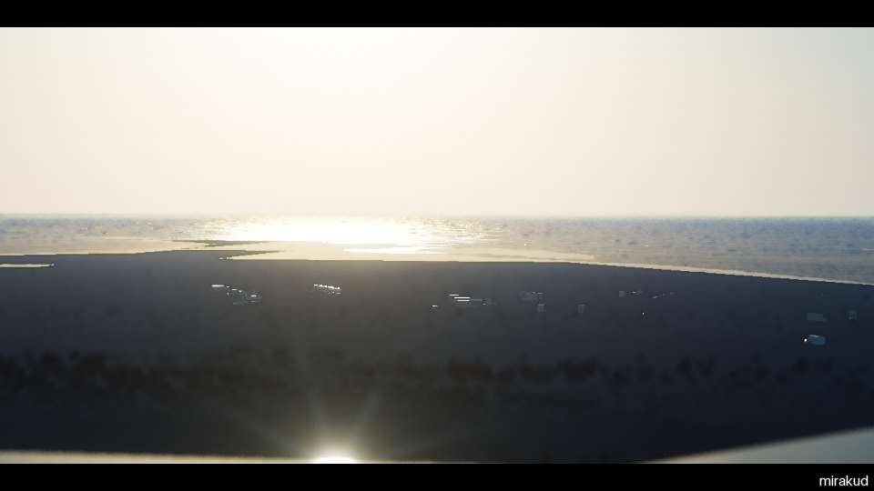

# Victory sur macOS

Victory est une couche de compatibilité qui traduit les appels d’un titre Xbox Series vers Direct3D 12. Cette branche expérimentale vise le rendu sur les Mac Apple Silicon, avec Wine Sikarugir et D3DMetal 4. Sur un Mac M3 de 16 Gio, le profil Series S permet de dépasser le carton d’introduction et de voir une rue nocturne, ses feux et un personnage. Le parcours 200227 atteint ensuite une voiture avec sa portière ouverte, puis un passage couvert. La ville apparaît sans bandes cinématiques avec une jauge verte en haut à gauche, puis les bandes reviennent sur un plan de côte éclairée. La scène reste trop lente pour être jouable et les parcours se terminent par un arrêt du titre.




| Rue au premier plan | Feux et matériaux pendant la transition | Personnage et horizon |
|---|---|---|
|  |  |  |

Les trois vues de référence proviennent du parcours 191652. Les surfaces très sombres et les matériaux transitoires restent visibles. Les deux grandes images montrent la rue puis la voiture dans le parcours 200227, avec restauration de profondeur active.

## Les neuf plans de 200227

La jauge des trames 1856 et 1864 apparaît encore pendant la cinématique, ce que le joueur a confirmé. Les bandes reviennent au plan de la côte. La prise de contrôle du personnage reste à vérifier. Chaque vignette ouvre la capture complète de 960 × 540.

| 1808 · Transition sombre | 1816 · Personnage dans la rue | 1824 · Rue et feux |
|---|---|---|
| [](docs/macos/frame-1808.png) | [](docs/macos/frame-1816.png) | [](docs/macos/frame-1824.png) |

| 1832 · Voiture, portière ouverte | 1840 · Horizon orange | 1848 · Passage couvert à piliers |
|---|---|---|
| [](docs/macos/frame-1832.png) | [](docs/macos/frame-1840.png) | [](docs/macos/frame-1848.png) |

| 1856 · Ville et jauge verte | 1864 · Ciel éclairé avec la jauge | 1872 · Côte, retour des bandes cinématiques |
|---|---|---|
| [](docs/macos/frame-1856.png) | [](docs/macos/frame-1864.png) | [](docs/macos/frame-1872.png) |

## État mesuré le 26 novembre 2026

Les essais ont utilisé un M3 de 16 Gio, Sikarugir Wine 10.0 révision 6, D3DMetal 4.0 bêta 3 et le profil Series S. Les médianes portent sur les relevés du journal dont la moyenne atteint 1 400 dessins par image. Le nombre de relevés, la caméra et l’avancement de la mission varient entre parcours. La différence de médianes ne mesure pas à elle seule un gain de performance.

| Essai | Relevés retenus | Médiane par image | Dont copies CPU | Pic de mémoire câblée macOS | Dernière trame du titre |
|---|---:|---:|---:|---:|---:|
| 191652, rue visible | 19 | 14,36 s | 9,08 s | 8 614 Mio | 963 |
| 195805, restauration de profondeur active | 6 | 6,85 s | 4,25 s | 8 662 Mio | 748 |
| 200227, jusqu’au plan du littoral | 36 | 10,02 s | 6,64 s | 9 126,7 Mio | 836 |

Les parcours 191652 et 195805 s’arrêtent sur la surveillance du titre. En 200227, le titre déclenche un point d’arrêt volontaire `0x80000003`. Son rapport à la trame 836 indique `INSTANCE_LIST 45000/45000`, contre `30819/45000` en 191652. Le lien causal avec la saturation de cette liste reste à établir. La garde mémoire était fixée à 9 216 Mio. Le relevé en jeu de 195805 atteint **1,0 restauration de profondeur par image**. Sur le banc D3DMetal séparé, trois tests passent. Les marches R16 0, 385, 32 768 et 65 535 produisent en D24 les valeurs hexadécimales 000000, 018101, 80007F et FFFFFF ; le stencil reste à 5A sur les quatre pixels. Le second dessin préserve également les profondeurs D32 de référence. [Sources du banc](crates/victory-gpu/src/host/depth_plane_readback.rs)

## Construire

La source intègre le candidat Victory `c9498925311320302f59e381f51e78aabe8a55ea`. Les tests de profondeur proviennent de `95732f4` et `b6bf7c8`. La cadence de capture diagnostique provient de `4541df7`. En mode `VICTORY_CAPTURE_WORLD=only`, `VICTORY_CAPTURE_WORLD_INTERVAL=1` enregistre un PNG à chaque présentation du monde. Les intervalles de 1 à 64 sont acceptés. La recette du candidat mesuré `c949892` reste la référence de 195805 et de 200227. Le README amont conserve le détail des composants, le modèle d’exécution et les instructions du projet. [Documentation amont](README.amont.md) · [Architecture](docs/architecture.md) · [État du ray tracing](docs/fork-ray-tracing.md)

Dans un terminal de développement Windows x64 avec le SDK Windows, Rust MSVC, Python 3 et le DirectX Shader Compiler de Microsoft sur le PATH, lancer les commandes suivantes. Le script compile les deux noyaux HLSL du projet en DXIL local avant que Rust n’embarque leurs octets. Le paramètre `--dxc` accepte un chemin explicite.

```powershell
python tools/shaders/prepare.py
cargo build --locked --release -p victory --features diagnostics
cargo test --locked -p victory-gpu --features diagnostics depth_plane_readback -- --test-threads=1 --nocapture
```

Les deux tests de dessin ont besoin d’un périphérique D3D12 et des composants de compilation du runtime. Le profil diagnostics permet la capture et la télémétrie employées pendant les essais. Le dépôt distribue les sources des shaders ; DXC et les produits générés restent locaux.

## Lancer un essai sur Mac

Le lanceur accepte des chemins locaux, y compris un volume externe monté. Il attend un moteur Sikarugir 10.0 révision 6 avec D3DMetal 4.0 bêta 3 installé, une bottle déjà configurée avec son disque Z sur la racine du Mac, le binaire Windows construit ci-dessus et le répertoire du titre préparé par son propriétaire. Le SHA des composants du runtime est contrôlé à l’ouverture. Python 3.11 ou ultérieur est nécessaire sur le Mac. Les données de test, le titre, la bottle, les runtimes et les paquets de shaders dérivés sont à fournir localement.

```sh
python3 tools/macos/run.py \
    --victory "$VICTORY_EXE" --title "$TITLE_EXE" \
    --engine "$SIKARUGIR_ENGINE" --bottle "$VICTORY_BOTTLE" \
    --output "$RUNS_DIR" --preview
```

Retirer `--preview` pour exécuter. `--data` copie les données privées d’un profil dans la nouvelle session. Les options `--shader-pack` et `--pipeline-manifest` acceptent des caches et priorités générés localement pour une version compatible. Au choix de profil du jeu, confirmer Player avec Entrée. Chaque session enregistre le journal et la télémétrie. Le moniteur arrête le groupe de processus à 9 216 Mio câblés ou dès l’erreur Metal de mémoire insuffisante. Le lanceur reprend les réglages de base de la rue, tandis que les profils, priorités spécifiques et entrées utilisées lors du développement restent propres aux essais.

### Afficher les performances en jeu

Ajoutez `--perf-hud` à la commande macOS. L’encart AppKit marqué « mirakud » suit la fenêtre de jeu, à 50 pixels du bord supérieur et du bord droit, et laisse passer les clics. Il se ferme avec l’essai. Les outils en ligne de commande de Xcode fournissent Swift pour sa compilation locale.

```sh
python3 tools/macos/run.py --perf-hud \
    --victory "$VICTORY_EXE" --title "$TITLE_EXE" \
    --engine "$SIKARUGIR_ENGINE" --bottle "$VICTORY_BOTTLE" --output "$RUNS_DIR"
```

| Indicateur | Lecture |
|---|---|
| FPS et temps image | Les FPS valent 1 000 divisé par les millisecondes par image rapportées sur l’intervalle du journal. |
| CPU Victory | 100 % correspond à un cœur occupé. 240 % correspond à environ 2,4 cœurs. |
| RAM Victory | Empreinte physique du processus relevée par macOS. La garde utilise séparément la mémoire câblée de tout le système. |
| Attente GPU | Temps écoulé côté hôte pendant l’attente de la clôture D3D12, en millisecondes par image. Le moteur mesure cette attente avec son horloge CPU. |
| Copies / image | Temps hôte consacré à préparer les copies, en millisecondes par image. Ces mesures couvrent des opérations du moteur dont certaines peuvent se chevaucher. |

Sur le démarrage de l’essai 202903, le panneau a reçu **21,14 FPS, 47,3 ms par image, 241,6 % de CPU et 3 730 Mio** pour Victory. Ce relevé valide l’affichage pendant le démarrage. La table des résultats plus haut décrit la rue. Plus tard dans le monde, un relevé affiche **0,11 FPS**, 9,39 Gio de RAM, 300 % de CPU, 8 794 ms par image, 1 547 ms d’attente de clôture D3D12 et 6 119 ms de préparation des copies. L’image ci-dessous est le panneau rendu par AppKit à partir de ce relevé archivé. WindowServer a confirmé en jeu que le panneau se trouvait devant la fenêtre Victory, à 50 pixels des deux bords sur écran Retina.


Une valeur absente ou périmée s’affiche sous la forme d’un tiret. Les comptes rendus de chaque session sont dans le dossier de sortie choisi. On peut les relire avec `python3 tools/macos/summarize_victory_run.py --help`.

## Crédits et provenance

Cette publication conserve les notices des projets et leur attribue les contributions intégrées. L’historique public de chacun reste accessible aux révisions indiquées.

| Projet | Contribution utilisée et provenance |
|---|---|
| VIctory, Marvisak et contributeurs | Chargeur, services du runtime, rendu D3D12 et recompilateur de shaders. Le fork Windows a démarré sur la révision `ffe310e`. GPL-3.0-or-later. [VIctory à cette révision](https://github.com/Marvisak/VIctory/commit/ffe310eb2098e52169f4c44db5ffdabf43a72622) |
| victory-fork, fxceless et contributeurs | Base directe du travail Mac, avec les ressources de rendu, le suivi des copies, les fenêtres de commandes indirectes et les files de soumission. L’ancêtre commun vérifié est `f85101b`. GPL-3.0-or-later. [Révision Windows](https://github.com/fxceless/victory-fork/commit/f85101b6095e8cf3cecf8f0647cc7f5428daa177) |
| victory-amd, myokex et contributeurs | Suivi des écritures à travers les vues d’une même page par myokex, d’après Spexivus, joroyt et tightfall. Lecture dans un tampon temporaire avant copie vers les pages du titre par Joshua Odom. Ces contributions ont été reprises dans la base Windows. [Gardes de page](https://github.com/myokex/victory-amd/commit/c6dc4d8c9fc80e8d2090f94287827cd3ffc0ac95) · [Lecture temporaire](https://github.com/myokex/victory-amd/commit/10ea38ed80e944e052b5f2221eee02b1717eda2b) |
| triippywhale et asdaasdsaddf | La base Windows a intégré les bornes du tas de vues de triippywhale et des correctifs de traduction des shaders et d’interpolation d’asdaasdsaddf. [Intégration des vues](https://github.com/fxceless/victory-fork/commit/31714deb2d70bb7c5a963658ad0faed0368526c6) · [Intégration des shaders](https://github.com/fxceless/victory-fork/commit/3bff182ef4966ad6986fd8552dc9c7c58268df07) |
| VIctory-macOS, pragyaangaur et contributeurs | Le diagnostic d’identités DXIL distinctes pour le cache D3DMetal a servi au port de l’identifiant de shader dans notre intégration Mac, conservé dans `crates/victory-shader/src/emit/container.rs`. La sélection des plans de présentation a servi de référence pour diagnostiquer les premiers écrans noirs. Le travail de **Stefa008** sur les conversions des canaux d’un export mesh avant ses écritures a inspiré les adaptations `054aaf5`, `24cbffc` et `8eaafd5`, présentes dans notre candidat. [Contribution de Stefa008](https://github.com/pragyaangaur/VIctory-macOS/pull/167) · [Diagnostic des hashes D3DMetal](https://github.com/pragyaangaur/VIctory-macOS/blob/a76ec9662bce135d90e15d28621da208409eef17/docs/macos.md#d3dmetals-shader-cache-needs-unique-shader-hashes) · [Plans présentés](https://github.com/pragyaangaur/VIctory-macOS/commit/87b6f05e90761cb4ff5f0ab55e546951d51edffd) |
| XCL, ivall et contributeurs | Référence comparative pour le comportement du titre dans une autre couche de compatibilité. Son dépôt est aujourd’hui sous xcl-dev et sa licence est GPL-2.0-only. [Projet XCL](https://github.com/xcl-dev/xcl) |
| Mirakud | Intégration et essais sur le M3, parcours et statistiques documentés ici, lanceur macOS, garde mémoire, encart natif et publication des sources. [Banc de profondeur](crates/victory-gpu/src/host/depth_plane_readback.rs) · [Outils macOS](tools/macos) |

Le moteur utilisé en externe associe Wine Sikarugir à D3DMetal du Game Porting Toolkit d’Apple, installé avec Uncork. La préparation Windows emploie le compilateur DirectX Shader Compiler de Microsoft. Ces composants conservent leurs conditions de distribution propres. [Sikarugir](https://github.com/Sikarugir-App/Sikarugir) · [Uncork](https://uncorkmac.com/) · [Game Porting Toolkit](https://developer.apple.com/games/game-porting-toolkit/) · [DirectX Shader Compiler](https://github.com/microsoft/DirectXShaderCompiler)

Les dépendances Rust sont épinglées par Cargo. Figurent notamment windows-rs 0.62.2 pour les interfaces Windows (MIT ou Apache-2.0), zlib-rs 0.6.8 pour la décompression (Zlib), opus-pure 0.2.4 pour l’audio (BSD-3-Clause) et BLAKE3 1.8.7 pour les empreintes (CC0-1.0 ou les options Apache indiquées par le projet). [Versions](Cargo.lock) · [windows-rs](https://github.com/microsoft/windows-rs) · [zlib-rs](https://github.com/trifectatechfoundation/zlib-rs) · [opus-pure](https://github.com/stephenberry/opus-pure) · [BLAKE3](https://github.com/BLAKE3-team/BLAKE3)

## Licence et contenu

Le code Victory est distribué sous GPL-3.0-or-later. Les attributions et notices d’origine sont conservées. Les tables constantes du format BCPack gardent leur statut particulier documenté en amont. Les copies d’affichage portent la signature « mirakud » en bas à droite. Le générateur contrôle la conservation de chaque pixel hors de cette signature. Les captures illustrent exclusivement les essais de ce fork privé ; la licence du code ne s’applique pas aux images du titre. [Licence](LICENSE) · [Règles amont relatives aux ressources](docs/asset-policy.md)
